# Task 3 — Development Log

## 19 October 2026 — Moving from concept to working prototype

Task 2 explored Urban Echo as a location-aware experience where the physical location forms part of the interface. Two concepts were considered: Landmark Stories and user-created Echoes. The second was chosen because it gives ordinary places personal meaning through memories contributed by visitors.

For Task 3, the priority is to demonstrate an actual interaction between device location and the content presented to the user, rather than producing static interface screens.

### Prototype scope and development decisions

The first prototype uses a responsive mobile-first layout with an interactive Leaflet/OpenStreetMap map, a device geolocation watcher, proximity-gated memories, and a form to leave an Echo at the user's current GPS coordinates. A 100-metre radius is an initial design assumption to be tested on a mobile device, not a proven optimal distance.

To keep the first iteration achievable, Echoes are currently stored in the browser's localStorage rather than a remote database. This proves the core interaction but means memories will not be shared between users or devices. The location and content are saved only in the current browser. The prototype initially has no seeded memories; users can create their own while physically present. The lack of a multi-user backend is a known limitation, not a completed feature.

The application checks whether GPS accuracy is within 100 metres before enabling creation. Echo stories are locked when the user is farther than 100 metres away, while titles and marker locations remain visible to guide discovery. These checks are client-side demonstrations and do not prevent spoofed positions or tampering.

The UI uses a dark palette with mint green for locations and unlocked interactions. On smaller screens, the map and Echo panel stack vertically.

### Technical approach

- Live map: Leaflet with OpenStreetMap tiles
- Sensor input: browser Geolocation API using watchPosition
- Spatial interaction: great-circle distance calculation for proximity
- State and persistence: JavaScript and browser localStorage
- Responsive layout: CSS grid and mobile media queries
- Graceful handling: GPS permission, timeout, low accuracy, and storage errors

### Testing and reflection — to be completed after real-device testing

The implementation has been committed to GitHub, but GPS tracking, permission handling, location accuracy, proximity unlocking, and mobile layout must still be verified on a physical phone. Screenshots, bugs found, corrections, and results will be recorded here only after tests have been carried out.

### Next iteration

1. Run the app through HTTPS on a real phone and capture evidence of the GPS state.
2. Test creating an Echo at the current location and viewing it nearby.
3. Move outside the interaction radius and test the locked state.
4. Address problems discovered, then evaluate a shared backend, privacy controls, and photo upload.
5. Record the working interactions for the final showreel.

**Development files:** [Urban Echo application repository](https://github.com/joshpilcher/urban-echo) · [Task 2 process journal](../index.html)

---

## 19 October 2026 — Iteration 02: making location response reliable

**AI-assisted development record.** This entry records implementation and automated browser observations made with Codex assistance. It does not describe a physical walking test or claim user feedback that has not happened. The original Task 2 concept/research sections remain unchanged.

### What the review found

The initial app already implemented the main concept, but the GPS watcher was represented by a boolean rather than its actual subscription ID. Retrying after failure could create additional watchers. A saved position also had no expiry, and discovery used distance alone even when the GPS reading was imprecise. These gaps could leave a story open, or attach a new memory to an old fix.

An actual Chromium click test exposed a separate interface bug: the original Leaflet CSS integrity hash was wrong. The browser rejected that stylesheet, leaving map tiles positioned over other controls. The test could not tap Enable GPS because a tile intercepted the pointer. The corrected hash matches the official Leaflet 1.9.4 CSS. Leaflet's JS/CSS and licence are now bundled in the app, while map tiles still come from OpenStreetMap.

A later browser geolocation-provider test exposed a transient-error case: changing the overridden device position briefly produced a location-unavailable callback before the next valid reading. Cancelling every failed watcher prevented recovery. The revised implementation cancels on permission denial, explicit stop, retry and page exit; temporary unavailability/timeouts invalidate the fix but keep the existing subscription available for the next reading.

### Design decisions and implemented changes

- **Make uncertainty visible.** The app retains the provisional 100 m discovery radius. A story opens when `distance + reported accuracy <= 100 m`. For example, 95 m away with ±15 m accuracy shows “checking GPS” rather than revealing the story. This is a cautious interaction rule based on an estimate, not a guarantee of physical presence.
- **Require a recent position.** A fix becomes unusable after 30 s. Stories relock and creation is disabled until a new reading arrives. A Refresh GPS action restarts the watcher if needed. This duration is a starting assumption; stationary-phone behaviour needs evaluation before keeping it for the final prototype.
- **Make tracking controllable.** Stop tracking clears the user marker and accuracy circle, relocks stories and cancels the watcher. Callbacks queued from previous subscriptions are ignored.
- **Save where the user is, not where the map points.** The form shows the latest coordinates and accuracy. Saving rechecks GPS and uses the position at submission, including if the user has moved while typing. Drafts survive GPS or storage errors while the page stays open; they are not saved across reloads.
- **Keep local memories compatible.** The original storage key is retained. Record fields and coordinate ranges are validated; corrupt records block writing instead of being silently overwritten. Saving rereads storage, and other-tab changes update the list. This reduces ordinary tab conflicts but does not make localStorage a transactional shared database.
- **Clarify discovery.** All Echoes and Within reach filters, distance sorting, a reachable count, distinct locked/checking/unlocked states and matching map markers make location response legible. No fictional memories are shipped to the normal app.
- **Improve small-screen use.** Controls have larger touch targets, form fields use 16 px text, dialog overflow is supported, keyboard focus is visible and retained across GPS list updates, and JavaScript map animation respects reduced-motion preferences.
- **Render contributions as text.** Leaflet interprets string tooltip content as HTML. Titles now enter tooltips as text-only DOM elements, matching the cards. A browser test confirmed an HTML-like title was not executed.
- **Keep the main loop available without map assets.** A missing map script or failed tile requests show a notice while GPS, the list and memory creation continue to work.

### Verification performed

**Result: 5 Node tests and 16 browser checks passed.** The [Node output](test-results-core.txt) and [browser output](test-results-browser.txt) are retained with this iteration.

Node tests exercise the distance calculation, exact/uncertain proximity states, freshness and accuracy rules, invalid coordinates/dates and valid v0.1 record compatibility. Browser integration tests exercise real DOM interactions with controlled GPS callbacks, plus Chromium's overridden geolocation provider. The test runner is committed so these checks can be repeated.

The browser checks cover permission denial and retry without duplicate subscriptions; recovery after a temporary error; creation at the GPS coordinates and persistence after reload; movement-driven locking and unlocking; low accuracy; failed-save draft retention; stopping and ignoring old callbacks; text-only tooltips; full storage; corrupt storage preservation; 30 s expiry; layouts and dialog bounds at 320, 390, 768 and 1440 px; uncaught JavaScript errors; the browser geolocation-provider integration; and the missing-map-script fallback.

**Environment:** Playwright 1.62.1 with headless Chromium 133 on Linux. The standard Playwright browser download was unavailable in the work environment, so a separate Chromium binary was used for the run. This is not an iOS Safari or Android Chrome test. GPS coordinates and memories in the evidence are synthetic test fixtures. Optional Google Fonts requests were disabled in the final runner so captures use the app’s normal system-font fallback. Chromium 133 still stalled on Playwright’s font-ready wait in a rerun, so capture was run with `PW_TEST_SCREENSHOT_NO_FONTS_READY=1`; this bypasses a screenshot wait, not a functional assertion. Basemap tile availability is a separate network dependency. Early browser runs without the environment’s network proxy showed failed tile loading while the list workflow continued to function. The final screenshot run used the proxy and loaded the OpenStreetMap basemap successfully.

### Captured browser evidence

These are screenshots of the implemented application, not design mock-ups. The banners identify simulated GPS and test content. They demonstrate interface states and error handling; they do not demonstrate a person physically visiting these places.

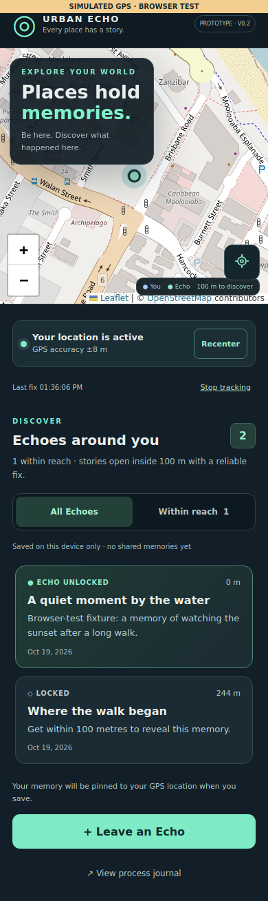

*390 px browser viewport: location status, uncertainty-aware discovery, local-only storage notice, and an unlocked and locked memory.*

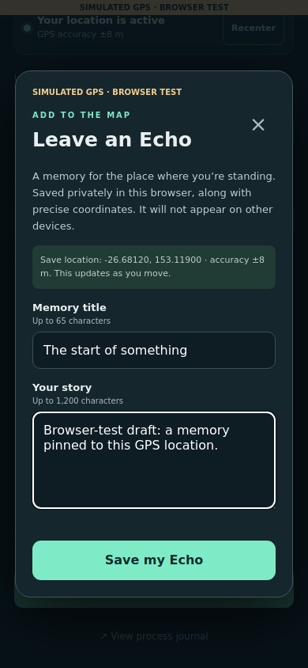

*Mobile form: precise save location and privacy explanation, bounded title/story fields, and a draft waiting to be saved.*

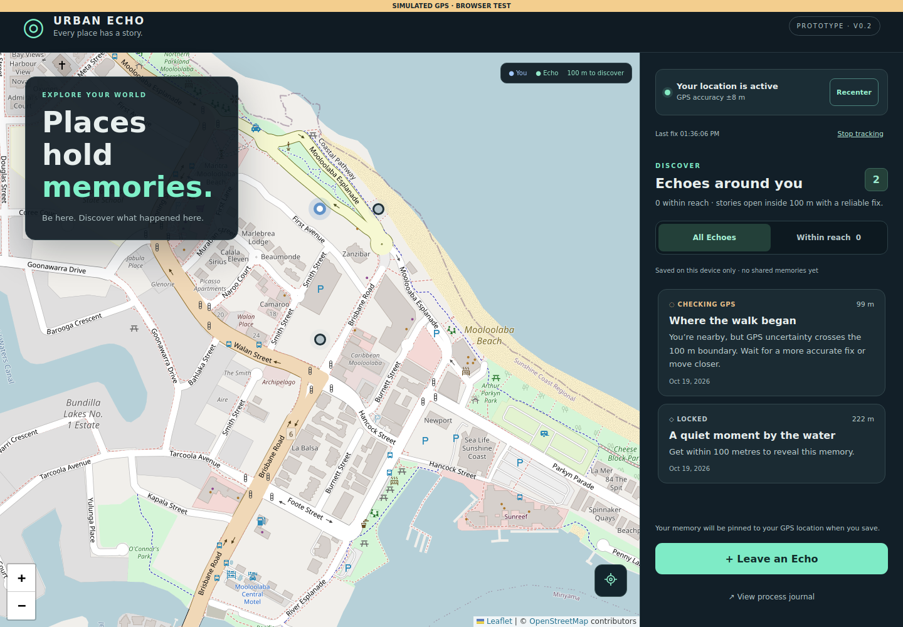

*1440 px browser viewport: the list and map adapt to the wider layout. A nearby memory remains closed when the accuracy estimate crosses the interaction boundary.*

### Development reflection and limits

The browser work showed why visible polish is not enough: the original code appeared to cover GPS, but a rejected stylesheet could make its controls unusable, and a transient location failure could stop later updates. Testing actual taps and browser callbacks exposed these issues.

The new checking state is more honest about GPS uncertainty, but may also frustrate someone who is already standing near a place. A field trial should record when it appears, how long it lasts and whether users understand how to proceed. Similarly, the 30 s expiry avoids stale access but could interrupt reading on a stationary device that does not emit regular updates. Neither setting has been validated outdoors.

This remains a single-browser prototype. Location gating is client-side and the local stories can be inspected in developer tools; it is not a security boundary. There is no shared storage, account system, photo upload, moderation or user-facing memory deletion yet. User testing, accessibility testing with assistive technology, physical-device GPS measurements and the final showreel remain outstanding.

### Next evidence and assessment milestones

1. Follow the [phone test checklist](https://github.com/joshpilcher/urban-echo#physical-phone-test-still-needed) on an HTTPS deployment. Record real device/browser, conditions, accuracy, lock/unlock distances and observed failures; add genuine screenshots and personal reflections.
2. Review the discovery radius and fix-expiry policy against those results.
3. Add shared storage with clear ownership, public/private scope and deletion behaviour. Then add validated photo uploads and error feedback; do not imply that existing local memories are already shared.
4. Record the final **1–3 minute standalone showreel**: explain the audience/place context, show enabling location, approach and reveal a memory, create a new memory, and show the prototype responding as the user moves away. Use actual device footage for claims about real-world response.
5. Finish the journal with a critique of the final outcome, supported by results. This supports Task 3's responsive technology, conceptual foundation, fabrication/finish and documentation criteria without presenting unfinished features as completed work.

### Technical references consulted

- [MDN — watchPosition](https://developer.mozilla.org/en-US/docs/Web/API/Geolocation/watchPosition): watcher lifecycle, permission and secure-context requirements.
- [MDN — clearWatch](https://developer.mozilla.org/en-US/docs/Web/API/Geolocation/clearWatch): cancelling location subscriptions.
- [Leaflet reference](https://leafletjs.com/reference.html): tooltip HTML/DOM content behaviour and map controls.

---

## 19 October 2026 — Separating the application and assessment journal

At Joshua’s request, the application moved to its own public repository, [joshpilcher/urban-echo](https://github.com/joshpilcher/urban-echo), matching the source repository’s visibility. The application HTML, CSS, JavaScript, Leaflet distribution, tests and package configuration now live at that repository’s root. This journal retains the completed Task 2 sections, Task 3 development notes, original source history and captured evidence.

The standalone application is based on the tested snapshot `fd3aacf307e0452104cd9d11b2b580f1ab7ef25e`. Its migration note links back to that source history. The new repository begins with an import commit; it does not claim to reproduce the original commit graph. Relative test paths, test-server URL and journal link were adjusted for the root layout. Generated app-test screenshots are ignored in `test-results/screenshots/` so repeated test runs do not replace assessment evidence automatically.

**Verification after separation:** five Node location-rule tests and 16 browser checks passed against the standalone root layout. For this relocation check, external HTTPS requests were deliberately blocked with `ECHO_TEST_OFFLINE=1`; this validates the local GPS/list workflow and map-failure handling, not live basemap delivery. [Node output](migration-test-results-core.txt) · [browser output](migration-test-results-browser.txt). The uploaded application tree was checked against the tested local tree and matched exactly.

The journal cleanup keeps a small `/app/` landing page pointing to the new repository, so the former entry point explains where the source moved. This change does not create a new live deployment or migrate browser-local memories to another origin. The existing journal draft PR contains this cleanup; the journal’s main branch changes only when that PR is merged. The completed Task 2 HTML remains unchanged.

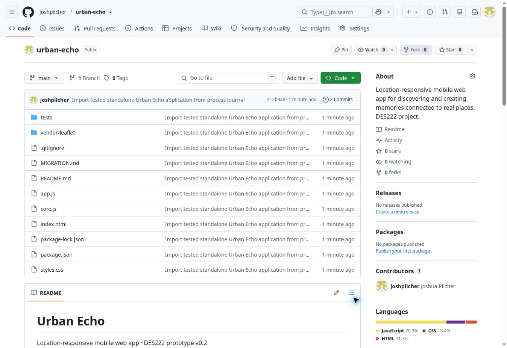

*GitHub repository after uploading the standalone application. This is repository-organisation evidence, not a new GPS field test.*

**Design reflection:** separating the source code from the assessment narrative makes the app easier to run and deploy independently, while keeping the process journal focused on decisions, outcomes and critique. Future app changes should be made in the new repository, with significant progress and genuine evidence recorded here.

---

## 19 October 2026 — Merge and HTTPS deployment

Joshua authorised merging the journal PR and publishing the standalone app. [PR #1](https://github.com/joshpilcher/urban-echo-process-journal/pull/1) was merged as `0e983854e9290c18e59d9b0a89ca2916f2090016`. The completed Task 2 sections were retained.

The application is now live at **[https://joshpilcher.github.io/urban-echo/](https://joshpilcher.github.io/urban-echo/)**. GitHub Pages is configured to deploy the application repository’s `main` branch at `/ (root)`, with HTTPS enforced on the default GitHub Pages domain. The initial [Pages build and deployment](https://github.com/joshpilcher/urban-echo/actions/runs/39202582914) published application commit `412b9a8bab0fa40dabd2c44953d16b89e7b4ac2e`.

**Live verification:** the published page opened over HTTPS in the browser and displayed the map, loaded OpenStreetMap tiles, location controls, discovery filters, local-storage notice and initial empty state. No location permission was granted and no real-world GPS walk was performed during this deployment check. The screenshot below is the actual published initial screen, without simulated coordinates or invented memories. Its map is the app’s default region, not a captured user location.

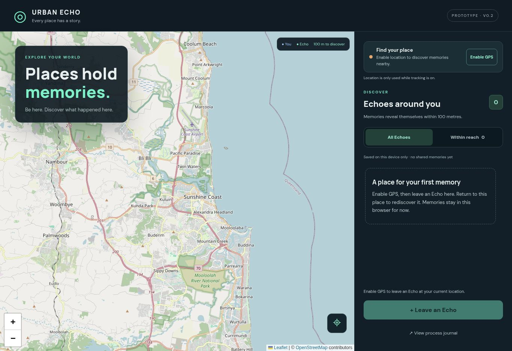

*Published desktop interface before enabling GPS. This establishes successful delivery and initial rendering, not phone GPS accuracy or proximity behaviour.*

The live app and journal now link to one another, and the former journal `/app/` entry point links to the deployed app. The application README also provides the live URL. Subsequent pushes to each repository’s configured main branch trigger their respective Pages rebuilds.

**Reflection and next test:** publishing the prototype makes it possible to test the device-location interaction on a phone over HTTPS. The next evidence should be a genuine create → move away → relock → return → unlock sequence, including the observed accuracy and any interruptions caused by the provisional 30-second freshness policy. Shared storage and photo uploads are still unimplemented; the deployed app remains browser-local.

## 19 October 2026 — First response to the live prototype

Joshua reported that the deployed app “works” but needs further polishing and more features. This is initial user feedback, not a measured outdoor GPS/proximity test; no device, accuracy readings, walk distances or screenshots were supplied with that feedback. A review of the current implementation identified the long stacked mobile layout, lack of a dedicated Echo detail view, and missing edit/delete actions as candidates for the next iteration. Feature and visual priorities are being clarified before implementation; shared storage and photo uploads remain planned rather than completed.

---

## 19 October 2026 — Iteration 03: photo memories and a closer visual match

Joshua selected **attach photos to memories**, **discover other people’s Echoes**, and **match the Task 2 mock-up more closely** as the next priorities. Development therefore moved from the initial stacked layout toward the Task 2 white/lavender surface, serif masthead, teal controls, map pins, rounded discovery sheet and photo-led detail view. The original mock-up remains unchanged in the completed Task 2 section.

### Implemented in this increment

- An expandable mobile map sheet and wider desktop sidebar, with working Map, Nearby and My Echoes views. Search filters titles; Photos and Stories filter real saved records. Controls that would imply unimplemented likes, audio or profiles were omitted.
- A dedicated memory detail view. It reacts to the same GPS state as the list: moving outside the discovery boundary hides the open story and photo again.
- A revised Create Echo screen with character counts, current GPS mini-map and an explicit visibility choice. The pin uses the GPS coordinates at submission, even if the map was panned. Draft text survives preparation, GPS and storage errors.
- Local photo attachment: JPEG, PNG and WebP files up to 10 MB are decoded, resized to a maximum dimension of 1600 px and re-encoded as JPEG below 1500 KB. Re-encoding discards the original metadata. Photos use IndexedDB rather than expanding localStorage records; the original text-memory format stays compatible.
- A two-step delete action removes device memories and their stored photo. Device-only remains the default; no existing memory is automatically uploaded.

### Shared discovery: prepared, not yet operational

The app now contains a Supabase adapter, the official vendored JavaScript SDK, a proposed database/storage migration and explicit Public consent text. The migration defines public reading and creator-only writes/deletion, with photo paths scoped to an authenticated anonymous contributor. Public sharing would reveal the title, story, exact pin and photo. The 100 m rule is an interface interaction, not protection for confidential content.

**Connection status:** Joshua installed the Supabase plugin. Its project tools were not exposed to the development session, so no project was selected, migration applied, live upload made or real multi-user discovery test completed. Project configuration remains empty and Public is visibly disabled. This is a tooling blocker, not evidence that the cloud feature works. The next step is to connect a dedicated project, enable anonymous sign-ins and verify RLS with independent users before enabling Public.

Anonymous ownership is a limited prototype decision: it avoids an account form, but clearing site data loses control of previously shared contributions. The first query is capped at the newest 200 public Echoes. Account recovery, moderation, geographic pagination and robust orphan-media cleanup remain future work.

### Testing and genuine evidence

**13 Node checks passed:** the five existing location-rule checks plus eight adapter contract checks using a fake SDK. The latter cover public reads without sign-up, owner-scoped photo upload, upload failure, uncertain insert reconciliation, failed-insert cleanup and deletion restrictions. A failed insert now checks whether its row committed before removing the photo; this avoids deleting an image after a success response is lost. These checks do **not** establish that real Supabase policies are deployed or correct.

**18 browser checks passed** in Chromium 133 with Playwright 1.62.1. The previous 16 GPS/storage/layout checks still pass, alongside photo type/decode errors, preservation of draft text, 2000 × 1000 → 1600 × 800 JPEG conversion, IndexedDB persistence after reload, hiding the photo without GPS, relocking an open detail view and deleting the blob. Responsive bounds were checked at 320, 390, 768 and 1440 px. External HTTPS requests were blocked for this run; cached tiles can appear in captures and are not evidence of live basemap delivery. This remains simulated GPS, not a measured outdoor walk.

[Node check output](iteration-03-test-results-node.txt) · [Browser check output](iteration-03-test-results-browser.txt)

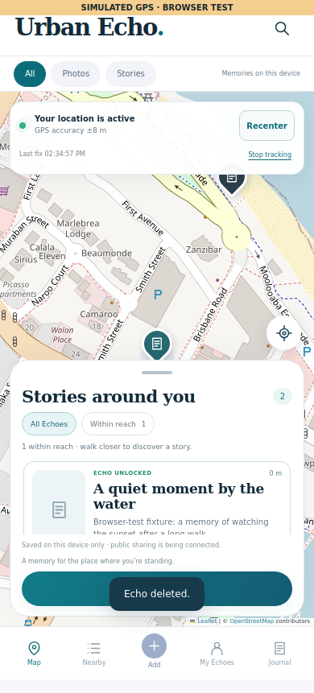

*Implemented interface, 390 px, with simulated GPS and written test memories.*

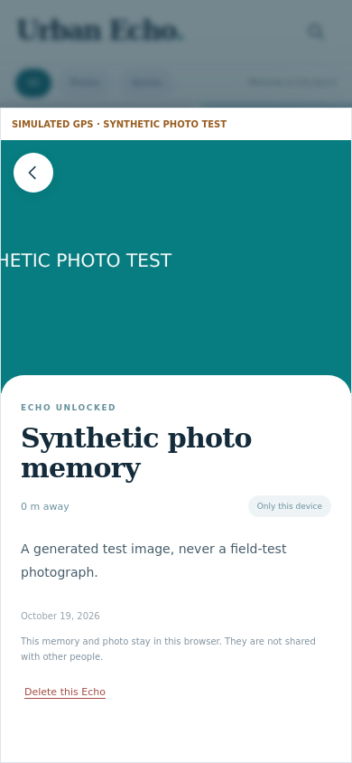

*The teal image was generated by the browser test as a validation fixture. It is not a photograph of a visited place. The screenshot shows the implemented photo detail view, with an explicit test label.*

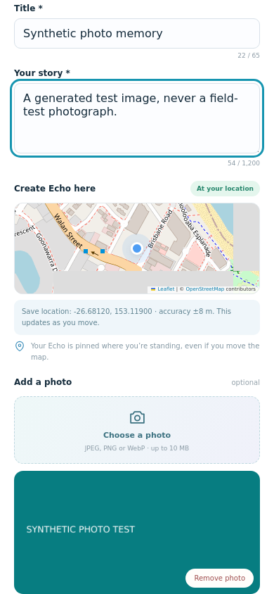

*Actual browser-rendered form and photo preview. The story and image identify themselves as synthetic test content.*

### Design reflection and remaining evaluation

The map sheet makes place feel central again and reduces the long mobile page, while the serif headings and teal palette reconnect the working prototype with the original visual direction. The detail screen gives a memory space to be read rather than fitting everything into a card. On small screens the compact sheet shows only part of a card; Nearby expands the list, but this interaction needs testing with people to see whether they notice it.

Client-side photo preparation reduces storage/upload size and avoids retaining original EXIF metadata, at the cost of rejecting HEIC and flattening image transparency. The browser fallback and camera/library selection still need iOS Safari and Android Chrome testing, including orientation, large photographs, keyboard overlap and device storage pressure. Automated browser results cannot establish those outcomes.

The next technical milestone is a verified two-session public photo contribution and discovery, with attempted cross-user writes/deletes rejected by the real service. The next assessment evidence remains a genuine phone create → move away → relock → return → unlock test and the standalone 1–3 minute showreel. No participant feedback, outdoor results or final personal reflection has been invented for this entry.

## 19 October 2026 — Supabase project and database provisioned

The Supabase tools became available after the previous entry. Joshua chose the student organisation for a separate Urban Echo project. The connector created `jamgivrngcderqmemjmb` in Sydney (`ap-southeast-2`); the existing inactive BikePark project was not modified.

Applied `urban_echo_public_memories` and `urban_echo_least_privilege_grants`. The second migration followed an inspection that found inherited INSERT, DELETE, TRUNCATE and other broad grants. It revokes all client-role table privileges, then grants only SELECT to public readers and SELECT/INSERT/DELETE to authenticated contributors. The row policies still restrict creation/deletion to the contributor ID. Verification confirmed RLS enabled, all six intended table/storage policies and the public JPEG bucket with its 1,572,864-byte limit. A real request to the table REST endpoint using the publishable key returned HTTP 200 and `[]`.

Supabase security advisors returned no findings after the change. The performance advisor reported two unused indexes on the new, empty table; they were retained for date ordering and ownership lookups. [Advisor explanation](https://supabase.com/docs/guides/database/database-linter?lint=0005_unused_index). An advisor result is not proof that the full multi-user workflow works.

The public Auth settings endpoint confirms `anonymous_users: false`. The connector has no Auth-settings operation, so the approved browser fallback was used. Dashboard sign-in reached a CAPTCHA requiring Joshua’s manual completion. No challenge was bypassed. Anonymous sign-ins have not been enabled, no test photo has been uploaded, and no two-user/RLS write test has been completed. The client configuration remains empty and Public remains disabled while this is unresolved. The next action is to finish dashboard sign-in, enable the anonymous contributor flow, and run the actual sharing/ownership tests before deployment.

Current Supabase changelog and documentation were reviewed, including explicit Data API grants and public-bucket access. This is backend provisioning evidence; the existing browser screenshots still represent simulated location and synthetic image tests.

## 19 October 2026 — Iteration 04: real shared photo discovery

Joshua completed the Supabase dashboard sign-in. Anonymous sign-ins were enabled for the dedicated Urban Echo project, and the browser client was connected using only the project URL and publishable key. Contributors are authenticated as anonymous users; reading public Echoes does not create an account. The default create option is still Only this device. Choosing Public explicitly shares the story, photo and exact pin; old device memories are not uploaded automatically.

### Verified against the real backend

**Seven live shared-storage browser checks passed**, using two isolated browser contexts and the actual Supabase Auth, database and Storage APIs. Location callbacks and the image were synthetic; the backend requests were real.

1. Both sessions read public Echoes without creating contributor accounts.
2. A deliberately interrupted row insertion left the photo draft and text intact. The app reconciled the row and removed the failed attempt’s uploaded object; retry succeeded.
3. Session A created an anonymous contributor and shared a JPEG photo and Echo through the actual form. No local memory record was created for this public post.
4. Session B refreshed and discovered A’s Echo. Its story/photo stayed closed without GPS, opened at the simulated location and relocked when the location moved away. The remote photo loaded, and B had no Delete control for A’s Echo.
5. Direct client API attempts confirmed backend enforcement rather than relying on a hidden button: unauthenticated insertion, an authenticated insertion with A’s owner ID, cross-user updates, uploading into A’s photo folder, deleting A’s row and removing A’s photo were rejected or affected zero records. A’s row/photo remained intact.
6. A reloaded, retained its anonymous creator session and deleted its Echo and photo. B’s refresh removed the contribution. A separate SQL check confirmed **zero Echo rows and zero objects in the photo bucket** afterwards. Two anonymous test Auth accounts remain; these are test sessions, not participants.
7. No uncaught application errors occurred during the shared workflow.

[Live shared-service output](shared-test-results.txt) · [Device-only regression output](connected-regression-results.txt) · [Node output](connected-node-results.txt)

The original **18 device-only browser checks** and **13 Node checks** also pass with the connected build. The regression runner explicitly injects empty cloud configuration so ordinary local tests never publish their synthetic memories; `npm run test:shared` is a separate, deliberate live-service run. The latter creates a uniquely labelled test Echo and removes it and its photo on completion.

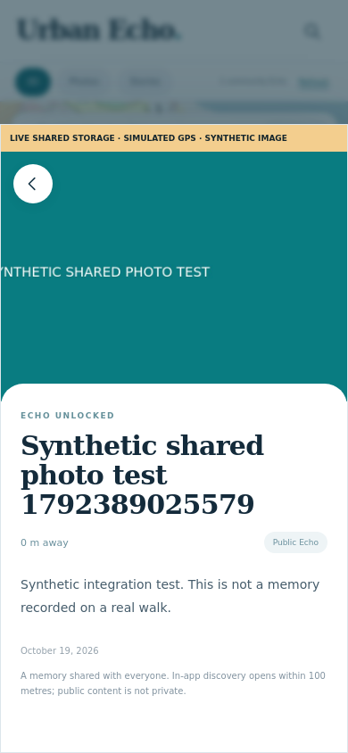

*Actual implemented screen in session B, reading session A’s real Supabase contribution. The banner distinguishes live shared storage from simulated GPS and the synthetic image. This is not evidence of two people meeting outdoors or a physical phone walk.*

### Security review and prototype limits

The final security-advisor run now flags Anonymous Access Policies on the Echo and storage policies because anonymous contributors are intentionally supported. The live tests confirmed those operations remain scoped to the creator. The advisor also flags leaked-password protection disabled on the default email provider, which remains enabled in Supabase defaults although the application offers no email/password flow. These are recorded, not presented as a clean production audit. [Anonymous policy advisory](https://supabase.com/docs/guides/database/database-advisors?queryGroups=lint&lint=0012_auth_allow_anonymous_sign_ins) · [Password protection guidance](https://supabase.com/docs/guides/auth/password-security#password-strength-and-leaked-password-protection).

Default anonymous sign-up rate limits remain in place; no CAPTCHA, moderation interface or account recovery has been added. Clearing site data loses an anonymous contributor’s ability to manage existing public posts. The prototype reads the newest 200 public Echoes and is not yet a scalable geographic feed. Public bucket URLs and API data remain public regardless of the interface’s 100 m reveal rule. These limits should be addressed before broader public use.

### Reflection and next evidence

Real sharing changes Urban Echo from a personal location journal toward the social concept in Task 2: a place can carry a memory left by someone else. Testing with independent sessions was necessary because local persistence alone could make the interface look shared without actually proving it. The direct ownership tests likewise showed that deletion restrictions are enforced by the backend, not just the interface.

The next evaluation should involve an actual phone photo, a public contribution and another device approaching it outdoors, recording GPS accuracy and lock/unlock behaviour. iOS/Android image orientation, camera selection, keyboard behaviour and storage pressure still need observation. The provisional 100 m discovery radius and 30 s freshness window remain unvalidated outdoors. The final 1–3 minute standalone showreel and Joshua’s personal evaluation remain outstanding; no field results or participant feedback have been invented.

### Publishing the connected prototype

[Application PR #1](https://github.com/joshpilcher/urban-echo/pull/1) was marked ready and merged as `23ea1b13e37808a400ea0eff88cf3a67c38da19a`. The [GitHub Pages deployment](https://github.com/joshpilcher/urban-echo/actions/runs/39206899280) completed successfully. The published [Urban Echo app](https://joshpilcher.github.io/urban-echo/) was opened over HTTPS and rendered the version 0.3 redesign, loaded basemap, enabled shared Refresh control and **0 community Echoes** after the live test cleanup. No GPS permission was requested or granted in this published-page check; it verifies delivery and the initial shared read, not field behaviour.

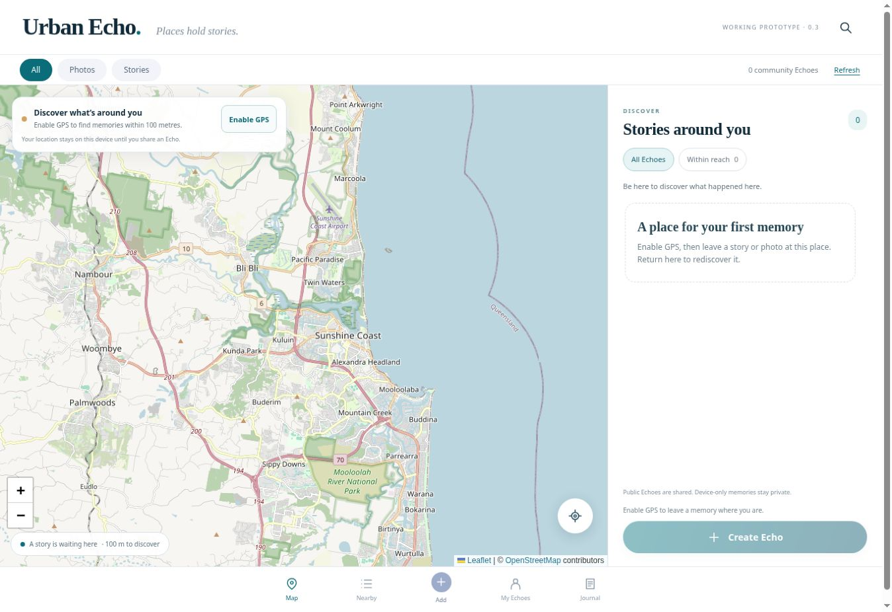

*Actual published initial screen after cleanup, with no simulated memories or real location granted. The Sunshine Coast map is the app’s default view.*

The completed Task 2 HTML was checked byte-for-byte against the original again and remains unchanged. This entry adds genuine Task 3 progress and preserves the earlier pending-state entries as a development record.

## 21 October 2026 — Iteration 05: cleaning up the phone interface

Joshua reported that the UI was not working well on mobile and asked for a cleanup. Reviewing the implemented layout showed a concrete problem: the map sheet compressed filters, status copy, privacy text, memory cards and creation into a limited-height overlay. Supporting text fell to 7–10 px, and the usable card area was too small. The original drag-handle-style button did not clearly communicate that it opened a larger list. This is user feedback and implementation review, not a new participant study.

### Design changes implemented

- **Map is a preview; Nearby is a reading/browsing screen.** The mobile map shows one complete memory preview and a visible View list control. Nearby and My Echoes fill the content area with readable, scrolling cards. Map or Show map returns to the map, and the navigation state now matches the displayed view.
- **A clearer hierarchy.** Filters and explanatory text appear in the full list rather than competing with the compact preview. The serif headings and teal visual direction from Task 2 remain, with larger card/body text and controls at least 44 px high. The duplicate mobile Add item is removed; the visible Create Echo button remains the main creation action.
- **Responsive space.** Small portrait screens use a shorter preview; short landscape screens put the map and preview side by side. The community status has its own readable line beneath the media filters. Hidden accessibility elements were positioned so they no longer add unwanted document overflow.
- **Create and detail.** The creation dialog follows the dynamic viewport and keeps its close/header available while scrolling. The detail close control has a persistent toolbar for long stories, and mobile photos use contain sizing so the complete image is visible. Real phone keyboard/safe-area behaviour still needs physical-device evaluation.

### Before and after

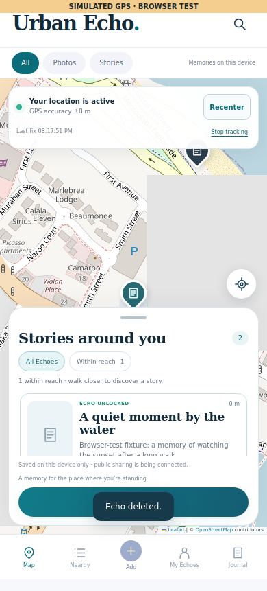

*Fresh browser capture of version 0.3 before the cleanup. Simulated GPS and synthetic memories; this is not an outdoor photograph or user test.*

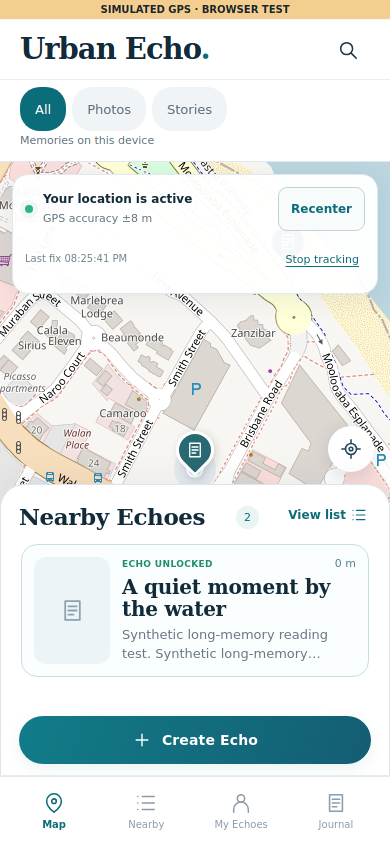

*390 × 844 browser viewport after the change. The test banner is outside the app area so it does not obscure the masthead. One complete card, a visible View list action and one primary Create Echo action replace the crowded compact sheet.*

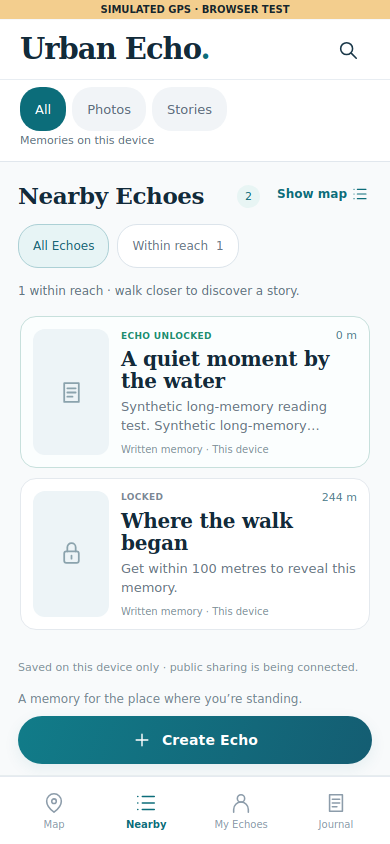

*The same implemented app in Nearby mode. GPS controls stay on Map while this screen prioritises cards, filters and scrolling. These regression captures deliberately use empty cloud configuration, so the device-only sharing notice describes the test configuration; the deployed app retains its real shared backend.*

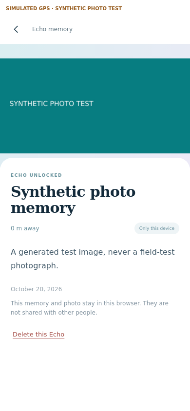

*Persistent close toolbar, larger story text and a complete synthetic test image. The teal graphic is a browser-drawn fixture, not a photograph from a visited place.*

### Verification and issues caught

**13 Node checks and 20 device-only browser checks passed.** The existing GPS permission/retry, temporary failure, proximity uncertainty, stale fix, local photo persistence/deletion and storage-error checks still pass. No backend schema, ownership policy or discovery threshold changed in this cleanup; the seven live backend checks from Iteration 04 were not rerun for this interface-only increment.

New checks cover 320 × 568, 390 × 844, 430 × 932 and 844 × 390 layouts: document bounds, full compact-card visibility, separation of GPS and preview controls, reachable creation controls, a 44 px list-toggle target, switching navigation state, scrolling to and opening the last card, title search, closing a long memory after scrolling, and reaching form controls in a reduced-height viewport. The small-phone bounds check initially failed; correcting hidden-element positioning removed the document overflow. A later check caught a card clipped after spacing changes, and increasing the short-screen preview allocation corrected it. These failures were fixed rather than treating a successful wide-screen render as proof of mobile usability.

[Browser results](iteration-05-browser-results.txt) · [Node results](iteration-05-node-results.txt)

### Reflection and limits

The main improvement is assigning different jobs to the two views: Map keeps place visible, while Nearby gives stories enough space. Showing one preview is a deliberate tradeoff; the count and View list button communicate that more Echoes exist. In a very short viewport, the preview omits the story excerpt and keeps the title/action; the full list remains available.

This is a tested browser layout improvement, not proof that Joshua has found the phone experience satisfactory. Actual iOS Safari/Android Chrome browser chrome, the keyboard opening, safe-area insets, landscape use and screen-reader behaviour still need hands-on checks. The reduced-height browser test is a useful approximation, not a physical keyboard test. Outdoor GPS evaluation, participant observations, the final 1–3 minute showreel and Joshua’s personal final reflection remain outstanding. The completed Task 2 sections are preserved.

**Deployment:** [Application PR #2](https://github.com/joshpilcher/urban-echo/pull/2) was merged as `461c3f136affe39ed789135e64f86009682a8b65`. The [Pages run](https://github.com/joshpilcher/urban-echo/actions/runs/39538677491) completed successfully and the published version 0.3.1 source was checked for the updated list toggle, detail toolbar and mobile stylesheet rules. The screenshots above are actual local browser renders of the tested implementation, rather than captures of a physical phone. The completed Task 2 HTML remains byte-for-byte unchanged.

## 21 October 2026 — Iteration 06: more of the screen belongs to the map

Joshua’s next feedback was that more of the map should cover the screen, the starting view should be closer, and the Nearby Echoes/recenter window should move out of the way. Iteration 05 improved reading, but its preview still occupied a substantial part of the mobile map. This update follows that more specific feedback.

### Changes

The mobile Map now fills the content area without an Echo list or memory-preview sheet over it. Cards remain in Nearby and My Echoes, and map pins still open memory details directly. Create Echo floats at the lower left and the recenter button sits at the lower right. The full Nearby list remains a separate navigation choice rather than appearing by default on Map. The larger desktop layout retains its sidebar.

The location window is replaced on mobile by a small top-left GPS chip. Before tracking it says Enable GPS; once an accurate fresh fix is available, GPS active opens accuracy, freshness and Stop tracking details. The details can be closed without stopping tracking. GPS failures open their explanation automatically, and a subsequent good fix closes that automatic notice. There is still no location request on page load.

The initial regional zoom changes from 12 to 13. The first GPS-centred view and recenter change from 16 to 17, giving a closer street-level view. The location itself, discovery radius, accuracy handling and 30-second freshness policy are unchanged. The keyboard skip link opens Nearby and moves focus without scrolling the app header away.

### Evidence and verification

*Previous iteration: the preview was readable, but still took a large portion of Map. Simulated GPS browser capture.*

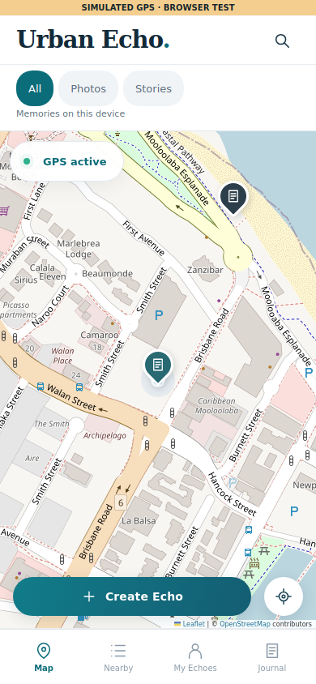

*Implemented mobile Map after the adjustment, 390 × 844 browser viewport. Only compact GPS, Create and recenter controls remain over it. The banner identifies simulated GPS and synthetic memories; this is not an outdoor trial.*

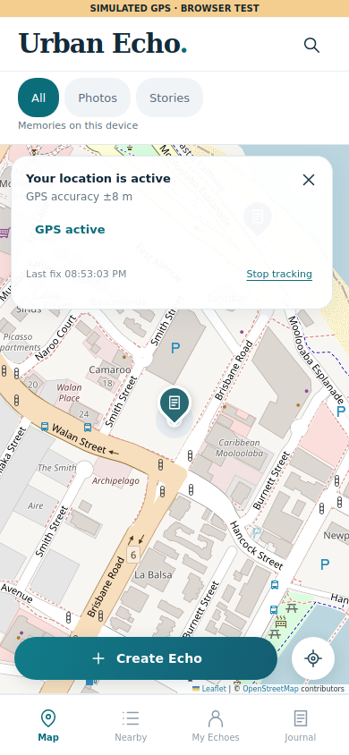

*The same screen after tapping GPS active. Tracking controls are available on demand rather than occupying the map continuously.*

**13 Node and 20 browser checks passed.** Updated cases verify full map coverage at 320 × 568, 390 × 844, 430 × 932 and 844 × 390; no default visible Echo list; compact GPS height; separated Create/recenter targets at least 44 px high; opening/closing location details; keyboard skip navigation; and access to the full Nearby list. Tile URLs generated by the actual Leaflet view confirm zoom 13 initially and 17 after the first simulated fix. Existing permission/retry, stop, stale-fix, proximity, photo persistence/deletion and storage-failure checks also pass. An old short-screen CSS rule initially kept tracking controls visible; removing that obsolete exception restored the compact GPS chip at small sizes.

[Browser results](iteration-06-browser-results.txt) · [Node results](iteration-06-node-results.txt)

### Reflection

This makes the original place-responsive idea more visible: the map is the main surface again, and reading/browsing is reached intentionally through a pin or Nearby. Hiding the preview means people must notice the pins or navigation; that tradeoff should be evaluated on a phone. The new closer view is a design choice rather than a field-validated optimum. It may need adjustment after actual walks or use in denser areas.

Physical phone browser chrome, touch behaviour, GPS accuracy and outdoor approach/reveal still require hands-on evaluation. No new participant feedback beyond Joshua’s request, real photographs or outdoor results have been invented. This interface increment makes no backend policy or storage changes, and does not repeat the earlier real shared-service tests. Completed Task 2 content remains preserved.

**Published:** [Application PR #3](https://github.com/joshpilcher/urban-echo/pull/3) was merged as `fc7f566b99e62529621ffad6335228c467b6b79e`. The [Pages deployment](https://github.com/joshpilcher/urban-echo/actions/runs/39541162068) succeeded. A fresh HTTPS request confirmed version 0.3.2 and the published initial/GPS zoom settings. The images above are local browser evidence of the tested mobile implementation, with simulated GPS explicitly labelled; they are not physical phone captures.

## 21 October 2026 — Iteration 07: replacing the top filters with a discovery prompt

Joshua asked to remove the top filters because they felt unnecessary, while adding something purposeful to Map so it would not feel empty. The All/Photos/Stories toolbar is removed, along with its unused media-filter state. Title search and the All Echoes/Within reach choices inside Nearby remain available.

Map now has one small discovery card. Without a fresh location it invites the visitor to find a story nearby. With a usable fix it shows the actual number of loaded Echoes within reach; when none are available, it says so and suggests leaving a memory or exploring Nearby. It also has copy for uncertain GPS and shared-read failure. The card does not insert example memories or invent nearby activity to fill the screen.

Tapping the card opens Nearby with Within reach selected when there is an unlocked Echo, otherwise All Echoes. Shared refresh is retained as a labelled icon beside the prompt, and the existing community loading status is still announced for accessibility. The compact GPS control moves down above Create so that it does not compete with the new card. Removing the toolbar also gives its height back to the map, while keeping the lighter serif/teal visual direction.

*Previous iteration: media filters above the map, with most of Map left open. Actual browser capture with simulated location.*

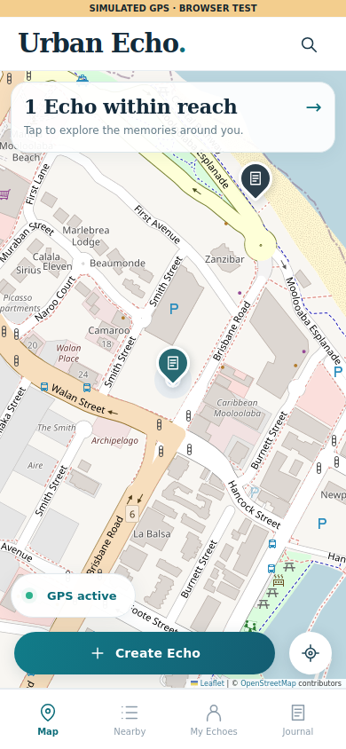

*Implemented 390 × 844 mobile browser view. The count comes from the synthetic test memories and simulated GPS; it is not a claim of real nearby activity. The regression configuration is device-only, so the shared-refresh icon is hidden in this capture. The deployed build retains its connected shared storage.*

**13 Node checks and 21 browser checks passed.** The added check exercises the discovery card’s GPS-dependent text, its shortcut into Nearby and the correct list filter for nearby versus distant memories. Existing checks now also assert that the media-filter controls are absent and that the discovery prompt, compact GPS, Create and recenter controls remain separated across 320 × 568, 390 × 844, 430 × 932 and 844 × 390 viewports. Existing GPS lifecycle, uncertainty, stale fix, photo, storage and accessible-navigation cases still pass. An early failure was in test setup: the shortcut check ran before its synthetic records were loaded; moving fixture installation before that check corrected the setup without weakening the assertion.

[Browser output](iteration-07-browser-results.txt) · [Node output](iteration-07-node-results.txt)

**Reflection:** this gives Map a clear next action and a sense of discovery without returning to a large memory sheet. The content is responsive to location rather than being a static marketing card. The tradeoff is that photo/story browsing is no longer a top-level filter; if people later need it, that choice could be placed inside Nearby. Physical phone touch, screen-reader use and outdoor GPS behaviour still need evaluation. No new field results, real photographs or participant feedback beyond Joshua’s request have been invented. Backend policies and storage behaviour were not changed, and the earlier real shared-service tests were not rerun for this interface increment. Completed Task 2 content remains preserved.

**Published:** [Application PR #4](https://github.com/joshpilcher/urban-echo/pull/4) was merged as `20181bdef6b439e7eca9599a26cb1cc75d9af00b`. The [Pages deployment](https://github.com/joshpilcher/urban-echo/actions/runs/39542484170) completed successfully. Screenshots above are local browser evidence with simulated GPS, not physical phone captures.

## 21 October 2026 — Iteration 08: recording sound and moving images

Joshua asked to add the ability to record videos and audio. This extends the core idea: a location can hold a voice, a short moving scene or an ambient sound, as well as a written story or photograph. This is a requested feature, not a new participant finding.

### Implementation and decisions

- Each Echo has one optional attachment: photo, video or audio. This keeps the mobile creation flow understandable and avoids multiple uploads competing with the GPS-dependent save. Existing photo/text records, the original localStorage key and the IndexedDB database/store remain compatible.
- Explicit Record buttons request camera/microphone permission. Video prefers the rear camera and includes microphone audio; audio requests only a microphone. The browser chooses a supported MP4/WebM/Ogg recording MIME rather than assuming one codec. Video shows a live muted inline preview; audio shows elapsed time. Stop/Cancel controls scroll into view and Stop receives focus once recording starts.
- Video stops at 30 seconds and is limited to 20 MiB; audio stops at 60 seconds and is limited to 8 MiB. Recordings have playback previews and can be removed/replaced before saving. File selection is available in an expandable fallback. Type, size, playback metadata and readable duration are checked. Imported files are not transcoded or stripped of metadata; the form says so. Existing photo re-encoding still removes original EXIF.
- Track cleanup covers stop, cancel, permission resolving after cancellation, capture errors, dialog close, hidden document and page exit. Leaving the foreground cancels an active recording rather than silently recording in the background. Text and an existing prepared attachment remain available for retry. Saving is disabled during capture/preparation; a fresh GPS fix remains required at save time.
- Local blobs use IndexedDB; only a media ID/type is added to the small saved record. Public contributions upload to the new `urban-echo-recordings` bucket. An additive schema migration adds nullable media fields, allowed kind/path checks, a one-attachment constraint and owner-folder Storage policies. The original photo bucket and its limits are unchanged.
- Map/list use media icons and do not preload recordings. Detail views use native audio/video controls with no autoplay and show playback errors. Valid GPS renders preserve the player element/position; relocking and closing stop playback. Required story text provides a place to transcribe spoken words. Automatic transcripts/captions are future work.

### Verification

**23 Node checks passed**, covering location rules, legacy/new record validation, upload adapter behaviour, MIME/limits and capture lifecycle with fake devices/clock. **21 existing browser regression checks passed**, preserving GPS, photo, storage, navigation and responsive behaviour. **12 local media browser checks passed** using actual Chromium MediaRecorder encoding with its synthetic camera/microphone: denial/unsupported fallback, closing camera and checking ended tracks, file size/type/duration validation, valid WAV import/removal at small and landscape sizes, preview, recording, reload persistence, actual playback, unchanged player across GPS updates, relocking and deletion. A failed photo replacement also retains an already prepared audio attachment.

**9 real shared-media checks passed** against the dedicated Supabase project. Audio and video were recorded, uploaded and played after reload and in another anonymous browser session. Cross-owner row deletion, object deletion and upload were rejected, and the creator removed both row and recording. A final database/storage read-back found zero synthetic recording rows and zero recording objects. Anonymous test Auth accounts remain; they are not participants.

Early harness runs tried clicking navigation/Refresh controls while their containing view was hidden. The tests were corrected to navigate through the visible Map screen first. Playback assertions were retained. Browser installation via the normal Playwright download failed in this environment; the existing alternative approach used the official Chromium 133 package with Playwright 1.62.1. Tests on that browser do not establish support on current physical iOS/Android devices.

[Node results](iteration-08-node-results.txt) · [Existing regression results](iteration-08-regression-results.txt) · [Local media results](iteration-08-media-results.txt) · [Real shared-media results](iteration-08-shared-results.txt)

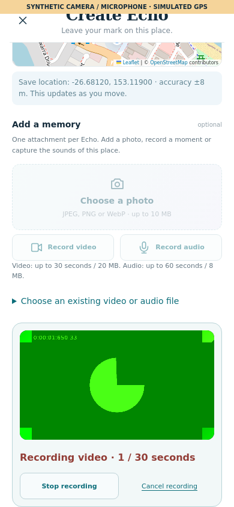

*Actual application capture at 390 × 844, using Chromium’s synthetic camera and microphone plus simulated GPS. The green test image is a device fixture, not outdoor footage.*

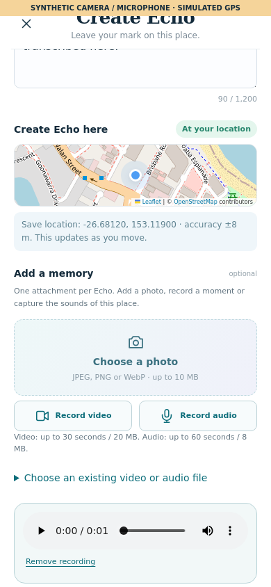

*Audio can be previewed and removed before saving. This is synthetic microphone input, not a personal recording.*

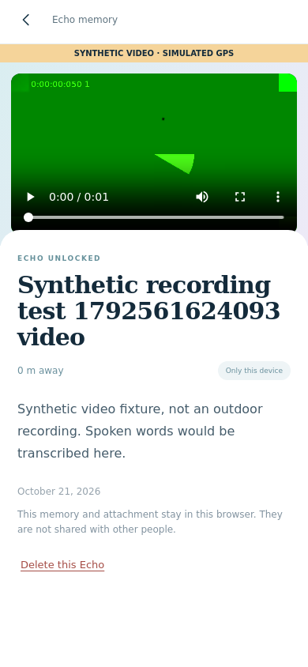

*Native video controls in the unlocked detail view. Synthetic content and simulated location, explicitly labelled.*

### Backend verification and limits

Read-back queries confirmed the added columns, CHECK constraint, allowed bucket types/size and three creator-folder policies. RLS remains enabled and existing least-privilege grants remain. The security advisor reports the same categories as before: [deliberately anonymous access policies](https://supabase.com/docs/guides/database/database-advisors?queryGroups=lint&lint=0012_auth_allow_anonymous_sign_ins), now also covering recordings, and [leaked-password protection disabled](https://supabase.com/docs/guides/auth/password-security#password-strength-and-leaked-password-protection) on the unused email/password provider. Real ownership tests accompany the policy review.

The Storage bucket enforces a 20 MiB MIME/size limit. Clip duration and the stricter 8 MiB audio limit are client validation, not server-side media inspection. Public URLs remain public; proximity is a discovery interaction, not confidentiality. No moderation/transcoding service or recovery flow has been added. Browser/codec playback may differ between devices, particularly imported formats. Public upload/row creation and deletion remain separate operations with the previously documented partial-network-failure limitations.

### Reflection and next evaluation

Audio makes the concept more about the experience of a place: the sound of an area or a voice describing a memory can carry meaning that a photo misses. Video adds movement, but increases upload size and demands attention. The short limits and one-attachment choice are provisional design decisions to keep creation manageable on a phone. Collapsing file import keeps the two recording actions visible without expanding the normal form unnecessarily.

The important remaining evaluation is physical phone testing: permission prompts, rear camera, microphone quality, changing foreground/background state, capture limits, actual network upload time, cross-device codec playback and outdoor approach/reveal. A real spoken memory also needs a readable transcript in its story. No real recordings, field outcomes, independent participants or user reflections have been invented. Completed Task 2 content is preserved.

**Published:** [Application PR #5](https://github.com/joshpilcher/urban-echo/pull/5) was merged as `742623233cc4aa857c53caa4c22679471fff33c1`. The [GitHub Pages deployment](https://github.com/joshpilcher/urban-echo/actions/runs/39551783053) completed successfully. Screenshots are local browser evidence, with synthetic input and simulated GPS labelled; they are not physical-phone captures.

## 21 October 2026 — Iteration 09: combining media in one Echo

Joshua clarified that he wants all media types in the same Echo. This revises the previous iteration’s one-attachment choice. The feature now treats an Echo as one location-tagged story with an ordered collection of photos, videos and audio, rather than asking the creator to choose a single medium.

### Design and implementation

The Create form appends media to the existing collection. Photo and audio/video file inputs support multiple selection; each new recording is added alongside the previous files. Each item has an individual preview and remove button, and a running count/combined size summary explains the limits. Invalid files do not remove the valid selections. The provisional limit is eight attachments and 50 MiB total, alongside the previous photo/video/audio per-file limits. Removing an item immediately frees its slot. Existing camera/microphone permission, Stop/Cancel and cleanup behaviour remains.

Unlocked detail renders all attachments in order with numbered captions and native controls. Each player keeps its DOM identity through valid GPS refreshes and asynchronous loading of other files, so loading a photo does not restart a video. Relocking removes all images/players and pauses playback. Nearby cards show the attachment count/types; map/list request only a cover photo thumbnail, not the full recordings. Native players remain user-controlled; no autoplay is added.

New local records store a small array of attachment IDs/types, with each blob separately in IndexedDB. If storing a later blob or the metadata fails, newly written blobs are removed and the draft stays intact. Reading old `photoId`/`photoPath` or `mediaKind`/`mediaId`/`mediaPath` records normalises them to a one-item gallery without rewriting the original memory or database store.

Public Echoes use an additive `attachments` JSONB column on the existing table. A server CHECK validates array shape, a maximum of eight items, unique UUID item IDs, allowed photo/audio/video kinds/extensions and exact creator/Echo/file paths. A non-empty collection cannot coexist with old single-media fields. The validator is immutable and security-invoker, has an empty search path, and performs no privileged operations. Existing RLS, grants, photo/recording buckets and owner-folder policies remain. No new exposed table is introduced.

Uploads finish before one Echo row is inserted. If a file upload fails partway through, the adapter checks whether the Echo already committed before cleaning attempted paths. It retains files when the outcome cannot be established, protecting a potentially successful contribution. Creator deletion groups all paths by bucket and removes them before deleting the row. Public media remains public outside the in-app proximity interaction.

### Verification

**29 Node checks passed**, including legacy/mixed record compatibility, ordered unique paths, one-row collection creation, count/size limits, partial upload cleanup, uncertain-outcome reconciliation and deleting all gallery items. **21 existing browser checks passed**, retaining GPS, photo, persistence, navigation and responsive coverage. The photo persistence test initially used the old `photoId` field; its accessor was updated to the new normalised attachment ID while retaining the JPEG type, size, dimensions, reload, relocking and blob deletion assertions.

**16 local media browser checks passed.** The new mixed case adds two synthetic photos plus actual browser-encoded audio/video from synthetic devices, removes one photo while keeping both recordings, fills all eight slots, removes extra items, rejects a bad file without clearing the others, checks small/large/landscape dialog bounds, and saves a photo/audio/video Echo. A forced localStorage failure confirms blob cleanup and the intact three-file draft, followed by a successful retry. Reload reveals all three types together; GPS refresh keeps the players, moving outside range removes all media and pauses them, and deletion removes every blob.

**14 real shared-media checks passed** against the dedicated Supabase project. The mixed case forces the second file’s upload to fail, verifies no partial Echo or files remain, and retries with the whole draft. All three media types then play in another anonymous session. That session cannot delete the creator’s files/row, and an attempted own-row insert referencing another creator’s gallery paths is rejected by the database CHECK (`23514`). The creator deletes every photo/recording and its Echo. Final read-back counts show zero synthetic Echo rows and zero nested gallery photo/recording objects. Anonymous test Auth accounts remain and are not participants.

[Node output](iteration-09-node-results.txt) · [Existing browser output](iteration-09-regression-results.txt) · [Local media output](iteration-09-media-results.txt) · [Real shared-media output](iteration-09-shared-results.txt)

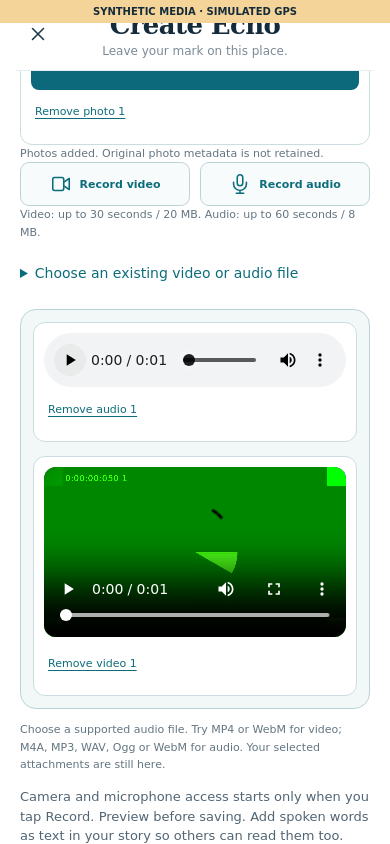

*Actual browser form after adding a photo, audio and video and rejecting an invalid file. The validation message and all valid selections remain visible. Synthetic media and simulated GPS are labelled.*

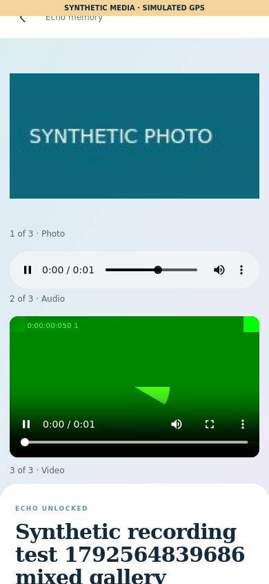

*One unlocked Echo with a photo, audio player and video, captured at 390 × 844. These are synthetic browser camera/microphone/image fixtures, not field recordings.*

### Backend review and limits

Read-back queries confirmed the new column and validated mixed input, wrong JSON shape, missing fields, duplicate IDs and foreign-owner paths. The advisor returned the same previously documented categories: [intentional anonymous contributor policies](https://supabase.com/docs/guides/database/database-advisors?queryGroups=lint&lint=0012_auth_allow_anonymous_sign_ins) and [leaked-password protection disabled](https://supabase.com/docs/guides/auth/password-security#password-strength-and-leaked-password-protection) on the unused email/password provider. No new advisor category was introduced by the validator. Actual two-session tests accompany this review.

The database enforces collection count and metadata paths, while bucket MIME/per-file size rules remain. Combined 50 MiB and clip duration limits are client checks, not server inspection. Files and the Echo row are separate service operations: unknown outcomes can leave temporary orphans, and a failed later deletion can leave a visible Echo with some missing files until retry. There is still no media transcoder, moderation interface, automatic transcript or account recovery. Cross-device codecs and real upload times need physical phone testing.

### Reflection

The earlier single-attachment design simplified capture, but Joshua’s feedback exposed an unnecessary creative restriction: a photo, a voice and movement can describe complementary parts of the same place. Keeping them under one story and pin makes that relationship explicit. The cost is a longer creation/detail flow and more upload work, so individual removal, a visible count and bounded storage are now more useful than automatic replacement.

The limits remain design choices rather than field-validated thresholds. Next evaluation should use real iOS/Android devices to test adding mixed files, permissions, keyboard/scrolling, upload delays, codec playback, leaving the foreground and outdoor approach/reveal. No real photographs/recordings, new participants or physical-device outcomes have been invented. Completed Task 2 content remains unchanged.

**Published:** [Application PR #6](https://github.com/joshpilcher/urban-echo/pull/6) was merged as `18463dd0629bc0b71ca83ce3e817f9f4eae3560b`. The [Pages deployment](https://github.com/joshpilcher/urban-echo/actions/runs/39557389331) completed successfully. The evidence above is local browser capture with synthetic input and simulated GPS, not a physical-phone test.

## 21 October 2026 — Iteration 10: returning to the original Echo detail composition

Joshua requested a multi-attachment viewing interface closer to the original Task 2 mock-up. Reviewing its centre screen showed a clear hierarchy: a large lead image, rounded story panel, compact audio and a small photo gallery. Iteration 09 had established mixed-media functionality, but stacked every attachment before the text, pushing the meaning of the Echo too far down the page.

The revised view uses one main photo or video above the story. A photo is selected first when available. Beneath the story/date, compact audio cards retain native playback, seeking and volume controls. A grid of labelled thumbnails selects photos/videos in the main viewing area, with a selected border and `aria-pressed` state. Video thumbnails use an explicit video icon. The main photo uses contain sizing to keep the complete image visible; smaller thumbnail crops make the collection easier to scan.

The lead area is shorter on phones than the previous stack, letting the title, story and audio appear sooner. The rounded story panel overlaps the image edge as in the original design. Extra space beneath video controls prevents that overlap from covering the native playback bar. The view handles photo/video collections, multiple audio recordings, audio-only and text-only Echoes. Existing creation, limits, metadata, storage and backend policies remain unchanged.

Playback uses persistent elements across valid GPS renders and thumbnail selection, retaining positions. Hidden videos pause; playing one recording pauses any other recording in the Echo. Relocking clears the main media, audio and thumbnails and pauses players. A new close test exposed the asynchronous timing of the dialog close event: the handler could run after an immediate playback assertion. Close and Escape now pause all players directly, with the close event remaining as a fallback. This was corrected before publication.

**29 Node, 21 existing browser and 17 local media checks passed.** The new UI case verifies one visible main visual, thumbnail selection and pressed states, keyboard Enter activation, audio placed after the story, at least 44 px thumbnail targets, no dialog overflow at 320 × 568 / 390 × 844 / 844 × 390, one active recording, video pause on switching, and audio pause on Close/Escape. Existing actual browser encoding, preview, mixed attachment persistence/reload, save-failure recovery, GPS relocking and deletion cases remain. These checks use synthetic camera/microphone/image input and simulated GPS.

[Node results](iteration-10-node-results.txt) · [Existing browser results](iteration-10-regression-results.txt) · [Local media results](iteration-10-media-results.txt)

*Previous iteration’s synthetic fixture: all full-size media appears before the story.*

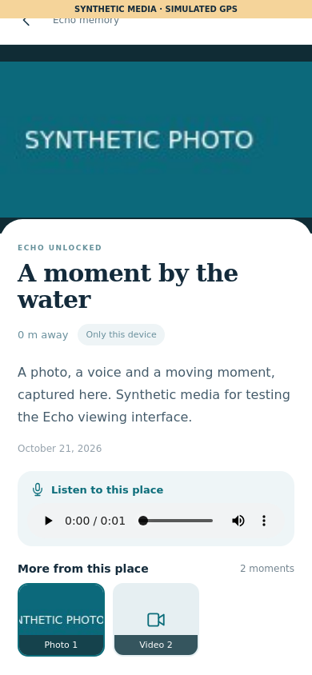

*New 390 × 844 browser view: lead photo, story, audio and thumbnails. The test fixture uses a shorter descriptive title and explicitly labelled synthetic media/GPS. It is not a real visitor memory or outdoor photograph.*

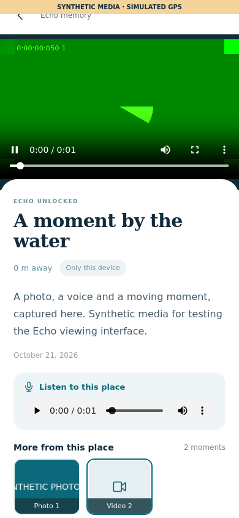

*Selecting the video thumbnail brings that recording into the main area. Native controls remain accessible above the rounded story panel.*

**Reflection:** grouping the attachments visually was not enough: their relationship to the story matters. The original mock-up gives the text a central place and treats the rest of the media as supporting moments. This change follows that hierarchy while keeping genuine playback controls and the working collection model. It also avoids making each additional file lengthen the page by a full image or video height. Multiple audio cards can still lengthen a large collection; this needs evaluation with real use rather than assuming the new arrangement is optimal.

The prior 14 real shared-media checks were not repeated because no backend behaviour or upload code changed. Physical iOS/Android controls, thumb reach, screen-reader use and outdoor discovery remain untested here. The original Task 2 content stays preserved. No new participant results, actual recordings or field evaluation are claimed.

**Published:** [Application PR #7](https://github.com/joshpilcher/urban-echo/pull/7) was merged as `f5c2c8582e542c12e8cffb8413e88c933bbd2914`. The [Pages deployment](https://github.com/joshpilcher/urban-echo/actions/runs/39561202576) completed successfully. The screenshots above are local browser evidence, with synthetic media and simulated GPS labelled.

## 21 October 2026 — Iteration 11: story first, full media and waveform audio

Joshua refined the viewing hierarchy: lead with the title and description, then show the other media in full. His attached audio reference showed a large teal play button, blue waveform and elapsed/total counter. This feedback revises iteration 10: the hero image and thumbnail selector are removed. The title, story and date now introduce the Echo, followed by audio cards and all photos/videos below. Complete images preserve their proportions; videos retain native playback controls.

The custom audio row follows the supplied reference while retaining real playback. Its waveform is calculated from decoded audio samples across every channel, using 48 RMS amplitude bins. It is not a decorative random pattern. A transparent labelled range input supports touch and keyboard seeking over the waveform; played bars change colour, the large button toggles play/pause, and the counter follows actual media time. OfflineAudioContext decodes existing files without asking for microphone access. Waveform fetching is bounded to the existing audio size/duration limits. Closing or relocking disposes the widget and aborts pending fetches; a late decode cannot update a disposed card.

Some browsers/codecs can play a file without exposing decoding or duration in the same way. If waveform decoding fails, the flat baseline and explanatory message preserve playback instead of presenting invented audio data. Seeking becomes available when duration is known. This fallback was explicitly tested by removing OfflineAudioContext in the test browser. Physical Safari/Android codec behaviour remains to be evaluated.

Playback remains stable across valid GPS refreshes. Playing audio pauses other recordings; playing video pauses audio. Close, Escape, leaving the foreground and proximity relocking pause playback. All media disappears on relocking. Creation, limits, shared database schema, bucket configuration and access policies are unchanged.

**29 Node, 21 existing browser, 18 local media and 14 real shared-media checks passed.** The new layout case verifies title/story before audio and visuals, every visual visible, no thumbnail selector, real waveform decoding, play/pause, keyboard seeking, time display, 44 px targets and no overflow at 320 × 568, 390 × 844 and 844 × 390. The fallback case confirms audio still plays without waveform decoding. Existing mixed creation, failure recovery, persistence, GPS refresh/relocking and deletion checks remain. The real-service run additionally verifies waveform decoding from shared Storage in another anonymous session and completes creator cleanup. Anonymous test Auth accounts remain. These are synthetic media/GPS tests, not participant or field results.

[Node results](iteration-11-node-results.txt) · [Regression results](iteration-11-regression-results.txt) · [Local media results](iteration-11-media-results.txt) · [Real shared-media results](iteration-11-shared-results.txt)

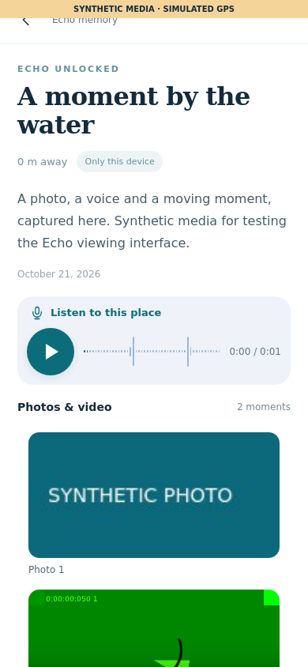

*390 × 844 browser capture: title and story lead, followed by a large teal play button, actual decoded waveform and full photo/video below. Synthetic media and simulated GPS are visibly labelled; the sparse waveform reflects the synthetic recording.*

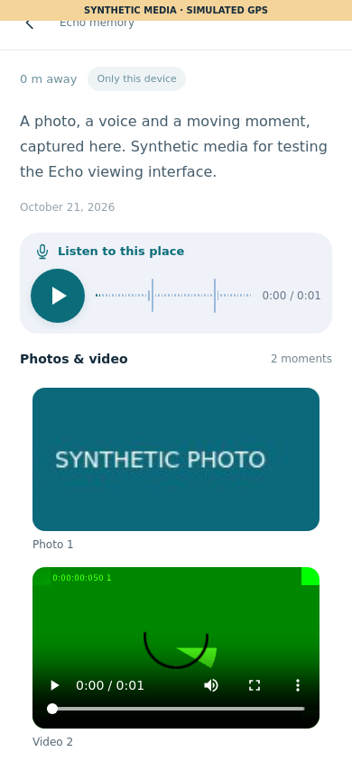

*The lower portion of the same synthetic multi-attachment Echo. Full images/videos replace thumbnail selection.*

**Reflection:** iteration 10 copied the original composition too literally: the lead image still delayed the story, and selecting thumbnails hid the other attachments. The revised hierarchy gives the place its meaning first and makes every visual available through ordinary scrolling. The tradeoff is a longer page for large collections. The waveform brings the sound memory closer to the mock-up while keeping meaningful seeking and feedback; it also adds decoding work and browser compatibility considerations. Real phone tests should assess thumb reach, scrolling through eight attachments, screen-reader operation, codecs and outdoor discovery before the final showreel. Completed Task 2 sections remain unchanged.

**Published:** [Application PR #8](https://github.com/joshpilcher/urban-echo/pull/8) merged as `7a6a04c5596c492a8a53e4790ba528a1333e92e5`. The [Pages deployment](https://github.com/joshpilcher/urban-echo/actions/runs/39565101692) completed successfully. Screenshots are local browser evidence using labelled synthetic media/GPS.

## 21 October 2026 — Iteration 12: shared Echoes become a conversation

Joshua asked for likes and replies to other Echoes, plus an Activity destination in the bottom navigation. The Journal link is now replaced by Activity. The new social layer keeps the location-responsive model: a visitor must have a fresh GPS fix and be within the Echo’s reveal radius before the controls appear. Device-only Echoes remain private and cannot receive public interaction.

A public Echo detail now has a Like button with a count and pressed state, followed by a reply thread and a short form. Likes are idempotent per anonymous browser identity and can be removed. Replies are limited to 500 characters, rendered as text, and can be deleted by their author. The control remains usable with keyboard focus and 44 px touch targets. A failed post keeps the draft so a temporary network problem does not erase someone’s response. Closing or relocking removes the interaction controls and clears the thread from view.

Activity is owner-scoped: it combines recent likes and replies from other anonymous visitors on the current user’s public Echoes, identifies the related Echo title, and opens that Echo when selected. It does not show the owner’s own interactions or interactions on someone else’s Echoes. The browser identity is still anonymous and temporary; clearing site data loses access to that identity.

The backend adds `urban_echo_likes` and `urban_echo_replies` with foreign keys to `urban_echoes`, cascade deletion, indexes for the feed, and RLS. Public reads are allowed, while inserts/deletes require the current authenticated anonymous user to match `user_id`. Policies block likes/replies on the creator’s own Echo and prevent forged author IDs or cross-user deletion. This additive schema does not modify existing media or Echo rows. Supabase advisors retain the previously documented anonymous-policy warning and report the new interaction indexes as currently unused in the small prototype; no new security class was introduced.

**29 Node, 21 existing browser and 10 live interaction checks passed.** The live run used three isolated anonymous browser sessions and synthetic GPS/content. It verified shared discovery, duplicate-like idempotency, failed reply recovery, literal text rendering, Activity ownership, forged writes/deletes, GPS relocking, delete cascades, reply deletion and 320 px/landscape layouts. No real participant or field interaction is claimed.

[Node results](iteration-12-node-results.txt) · [Regression results](iteration-12-regression-results.txt) · [Interaction results](iteration-12-interactions-results.txt)

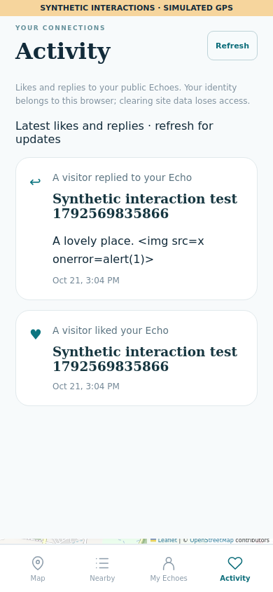

*Activity shows recent likes and replies received on the owner’s public Echoes. Synthetic fixture and simulated GPS.*

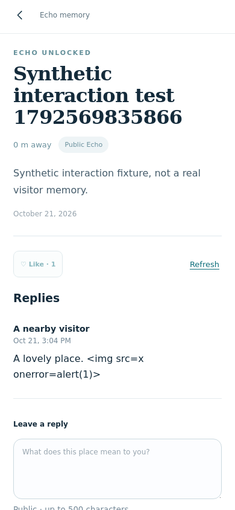

*Unlocked public Echo detail with the like control, reply thread and delete control for the current anonymous author. Synthetic content.*

**Reflection:** likes make a quiet memory discoverable, while replies let people add their own relationship to a place. The 100 m gate keeps the interaction connected to being there, but it is still an interface rule rather than proof of physical presence. Activity is more useful than linking back to the process journal during a visitor session, while the journal remains available as a separate project link. Anonymous identity is convenient for a prototype but fragile across browsers and cleared site data. Next evaluation should test moderation, report/block behaviour, abuse limits and real multi-person use on phones.

**Published:** [Application PR #9](https://github.com/joshpilcher/urban-echo/pull/9) merged as `6e8698d5f0467ded815b49a550640e80f6a29cfb`. The [Pages deployment](https://github.com/joshpilcher/urban-echo/actions/runs/39567000791) completed successfully. Screenshots and checks use synthetic fixtures, not field evidence.

## 21 October 2026 — Iteration 13: removing floating map titles

Joshua’s iPhone screenshot showed an Echo title compressed into a tall, one-character-wide tooltip over the map after returning from a memory. Echo markers no longer bind a floating title tooltip or reopen it after selecting a detail. The native HTML title is also removed; the marker retains an accessible alternative label. Titles remain available in the Nearby list and the Echo detail. This keeps the map focused on location and avoids the intrusive vertical label on small screens.

The browser regression case now checks literal title rendering in the detail, no Echo tooltip after returning to the map, and no native marker title attribute. These are browser checks rather than a physical iPhone retest. No GPS, storage or interaction policy changes were needed.

**Verification:** all 21 browser regression checks passed, including the revised no-floating-title case. [Browser results](iteration-13-regression-results.txt). [App commit](https://github.com/joshpilcher/urban-echo/commit/3e6c5fdeae4d6888e3958d6b0fe135d32bfa793a).

## 21 October 2026 — Iteration 14: consistent audio controls when creating

Joshua requested the same audio UI in Create Echo as in the viewing screen. Draft audio attachments now reuse the existing EchoAudio component: a large teal play/pause button, decoded waveform, seek control and elapsed/total timer. The lavender card and audio heading also match the detail design, while each draft keeps its individual Remove action. Both microphone recordings and uploaded audio pass through the same preview renderer.

Starting one draft recording’s playback pauses any other audio/video preview. Rebuilding or removing a preview disposes the waveform component and aborts pending fetches; page exit also disposes draft widgets. Existing close/foreground handling pauses playback. Recording permissions, file limits, storage and GPS rules are unchanged.

**All 18 local media browser checks passed.** The upload case now verifies actual waveform decoding, 48 waveform bars, custom play/pause, keyboard seeking, hidden native audio controls and a minimum 44 px button at 320 px width. Existing microphone capture, mixed attachments, failed-save recovery, removal, reload, playback and proximity relocking also passed. These use synthetic devices and GPS rather than physical phone testing. Shared-service checks were not repeated because upload/storage code did not change.

[Media test results](iteration-14-media-results.txt) · [Application commit](https://github.com/joshpilcher/urban-echo/commit/8d482ffdee68715a4ebd8c634982cd84d051f71d)

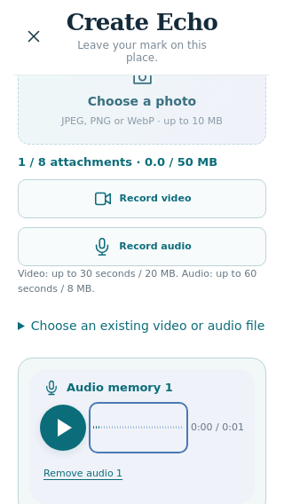

*Actual 320 × 568 automated browser capture with a synthetic one-second WAV and simulated GPS. The flat waveform represents the silent fixture; the visible focus ring shows keyboard seeking.*

**Reflection:** reusing one playback component keeps the create and reveal flows consistent and avoids maintaining two different sets of audio controls. Removing the native player does require preserving accessible labels, keyboard seeking, playback feedback and a decoding fallback; the existing component supplies those behaviours. Physical phone touch, codecs and screen-reader evaluation remain outstanding. Completed Task 2 content is preserved.

## 22 October 2026 — Iteration 15: video previews before playback

Joshua requested visible video previews in Create Echo and the Echo viewing interface. Both now extract a real still from each recorded/uploaded video, near the beginning, and use it as the native player’s poster. This avoids a blank player while keeping the visible clip paused at time zero. The story continues to lead the detail view, with video below the text. Native controls retain play, seeking, volume and fullscreen.

A separate muted video element decodes the still without autoplay. A canvas scales the extracted frame to at most 640 pixels on its longest edge and creates an in-memory JPEG. Posters are generated locally rather than uploaded or stored in the database. Disposing an attachment cleans up the decoder, timeout and generated object URL. Relocking removes the video and preview together. The decoder has a 15-second timeout; when browser decoding or CORS prevents a still, a clear Play placeholder keeps native playback available. Preview generation can require additional media loading, which needs evaluation on slower mobile connections.

**18 local media and 14 real shared-media browser checks passed.** New assertions verify a generated poster in the creation form and after reload/reveal, while the actual video remains paused at time zero. The second-session mixed-gallery case also verifies a real poster generated from public Storage before playback. Existing recording, draft validation, upload failure recovery, persistence, playback, GPS refresh/relocking and creator cleanup passed. These tests use synthetic Chromium camera/microphone input and simulated GPS. Physical iOS/Android preview behaviour remains unverified.

[Local media results](iteration-15-media-results.txt) · [Real shared-media results](iteration-15-shared-results.txt) · [App commit](https://github.com/joshpilcher/urban-echo/commit/d05a57bc5c819c3fb60529e8bd44d3ee2b490569)

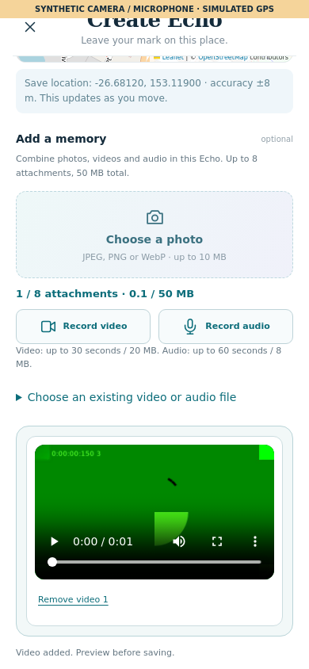

*Automated 390 × 844 browser capture. The green frame is Chromium’s synthetic camera fixture, not real footage. The preview is visible before playback.*

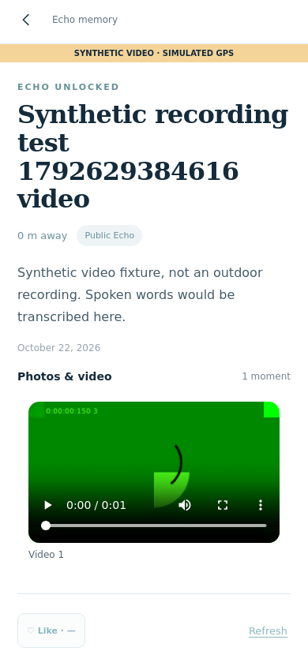

*The story remains first, with a real extracted synthetic video frame and native controls below. Synthetic media and simulated GPS are labelled.*

**Reflection:** a still gives visitors an immediate clue about an attachment before committing to playback and makes the creation preview useful for checking a selected clip. Extracting it from the actual video avoids fabricated imagery. The extra decode and mobile browser differences are a tradeoff; future physical-phone evaluation should include portrait clips, slow connections and codecs. No backend schema or media-upload changes were needed. Completed Task 2 content remains preserved.
